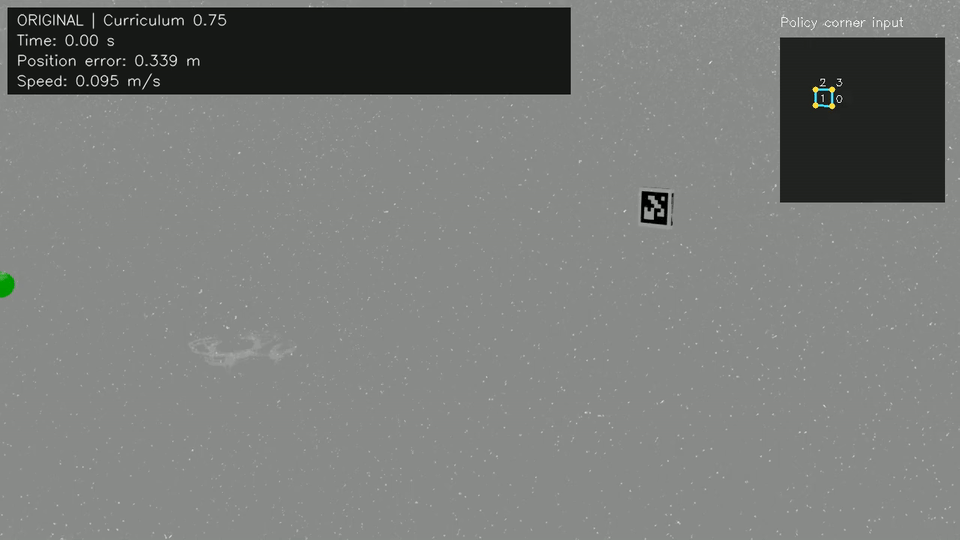

# Visual Quadrotor Control

  

  <em>Vision-based quadrotor recovery and precise hover using the end-to-end Transformer controller (5 seconds, real time).</em>

Structured visual representation learning for high-performance quadrotor control using physical-state supervision, imitation learning and DAgger.

## Results

Independent evaluation at maximum curriculum difficulty:

| Metric | Frozen representation | End-to-end |
|---|---:|---:|
| 10-second survival | 1023/1024 | 1023/1024 |
| 60-second survival | 256/256 | 256/256 |
| Continuous precision after 10s | 100% | 100% |
| Original position error, 60s | 2.675 cm | 2.383 cm |
| Expanded position error, 60s | 2.700 cm | 2.387 cm |
| Expanded lateral error, 60s | 6.572 mm | 7.812 mm |
| Expanded residual speed, 60s | 0.380 mm/s | 0.500 mm/s |
| Worst expanded error after 10s | 4.487 cm | 3.786 cm |

## Architecture

The policy receives 32 frames of normalized ArUco corner coordinates and eight previous four-dimensional control commands.

Three temporal Transformers encode geometry, linear velocity and angular velocity. A spatial attention branch encodes the latest marker observation and predicts relative pose.

The combined 293-dimensional representation feeds a 293-256-128-4 controller producing normalized collective thrust and body-rate commands.

Physics runs at 500 Hz and policy inference at 50 Hz. No privileged state or IMU measurements are supplied to the deployed actor.

## Repository structure

| Directory | Purpose |
|---|---|
| networks/ | Temporal and spatial Transformers |
| controllers/ | Learned control policies |
| rl/ | Training and data collection |
| envs/ | Isaac Lab environments |
| models/ | Physical simulation assets |
| evaluation/ | Evaluation and video recording |
| experiments/ | Research methods and ablations |
| checkpoints/ | Selected trained models |
| configs/ | Configuration |
| docs/ | Research and reproducibility |
| tests/ | Integrity tests |
| utils/ | Shared utilities |
| scripts/ | Asset generation |

## Requirements

Isaac Sim 5.0, Isaac Lab, Python 3.11, CUDA-enabled PyTorch, RSL-RL and OpenCV. FFmpeg is required for recording videos.

Run all commands from the repository root.

## Trained policies

Primary controller: checkpoints/hover/end_to_end/policy.ts

Frozen representation baseline: checkpoints/hover/frozen/policy.ts

Both TorchScript policies accept corner histories of shape (B, 256) and action histories of shape (B, 8, 4).

## Record a flight

    python -m evaluation.record_flight --policy checkpoints/hover/end_to_end/policy.ts --out results/runs/demo --device cuda:0 --levels 0.0 0.25 0.5 0.75 1.0 --domains original expanded --duration 10 --camera-offset -0.65 -1.10 0.35

## Documentation

- [Training instructions](docs/reproducibility/TRAINING.md)
- [Research results](docs/research/FRESH_STUDENT_REPRODUCTION.md)
- [Training input manifest](docs/reproducibility/training_inputs.json)
- [Independent evaluation results](docs/research/fresh_student_results/)

## Limitations

Results use analytically projected marker corners in simulation. Real-camera deployment, representation retention following joint optimization, implicit system identification and cross-robot generalization remain future research directions.

Selected trained checkpoints are included in Git. Large datasets, historical experiment outputs and training logs remain local.
